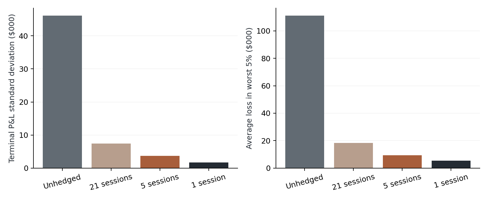

# Options pricing and hedging

**George Dharma · Quant portfolio · Python 3.12**

How accurately can we price a European put, and how much protection does a delta hedge provide after trading costs? This project compares analytical, tree and Monte Carlo pricing, then follows the cash and shares behind several hedge schedules.

**[Read the worked notebook](notebooks/analysis.ipynb)** · [Browse the Python code](options/) · [Read the report](docs/report.pdf) · [Run it yourself](docs/RUNNING.md)

The notebook includes explanations, formulas, tables and saved charts. You can review it on GitHub without running the analysis.

## Main finding

In the base simulation, daily hedging reduces the average loss in the worst 5% of outcomes from about $9,402 with five-session hedging to $5,477. Average financed trading costs rise from about $640 to $1,167. Jump risk remains substantial.



**Scope:** Illustrative European put with spot $36, strike $40 and one year to expiry. Hedge results use 30,000 simulated paths per case for a short position of 10,000 option units. These are model experiments, not historical trading returns.

## What the code demonstrates

Black–Scholes · binomial trees · Monte Carlo · Greeks · implied volatility · self-financing hedges · simulation checks.

## Find your way around

| File or folder | Purpose |
| --- | --- |
| [`notebooks/analysis.ipynb`](notebooks/analysis.ipynb) | Start here: the complete worked example |
| [`options/engine.py`](options/engine.py) | Prices, risk measures, simulated paths and cash accounting |
| [`options/analysis.py`](options/analysis.py) | Pricing comparisons, hedge experiments, summaries and exports |
| [`run_analysis.py`](run_analysis.py) | Run the full calculation from one command |
| [`data/`](data/) | Fixed inputs and their source information |
| [`outputs/`](outputs/) | Saved tables and charts; regenerated by the code |
| [`tests/`](tests/) | 20 financial and numerical checks |
| [`docs/METHODOLOGY.md`](docs/METHODOLOGY.md) | Detailed assumptions, conventions, sources and limitations |

## Run the analysis

Download the complete repository using **Code → Download ZIP**, then extract it. Use Python 3.12 and open a terminal in the folder containing `run_analysis.py`.

On Windows PowerShell:

```powershell
py -3.12 -m venv .venv
.\.venv\Scripts\python.exe -m pip install -r requirements.txt
.\.venv\Scripts\python.exe run_analysis.py
.\.venv\Scripts\python.exe -m unittest discover -s tests -v
```

For macOS/Linux, JupyterLab and troubleshooting, see [the step-by-step instructions](docs/RUNNING.md). The analysis runs from bundled inputs without API keys. Rerunning overwrites generated outputs. [Validation notes](docs/VALIDATION.md) explain the checks performed.

## Sources and reuse

Source attribution and data provenance are retained in [the methodology](docs/METHODOLOGY.md) and `data/`. See [source and rights notes](NOTICE.md). This repository presents an independent portfolio research exercise; the referenced organisations do not endorse it.
